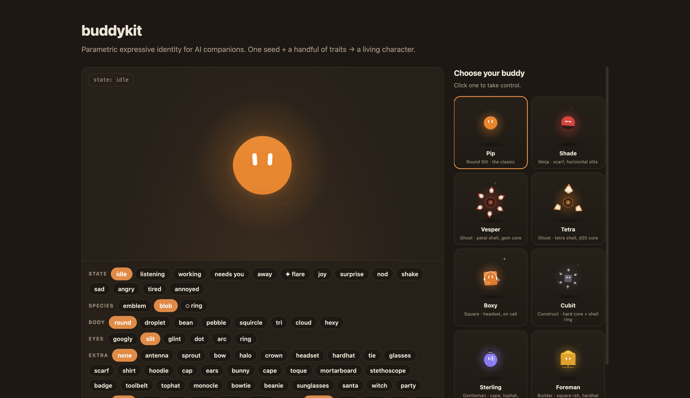
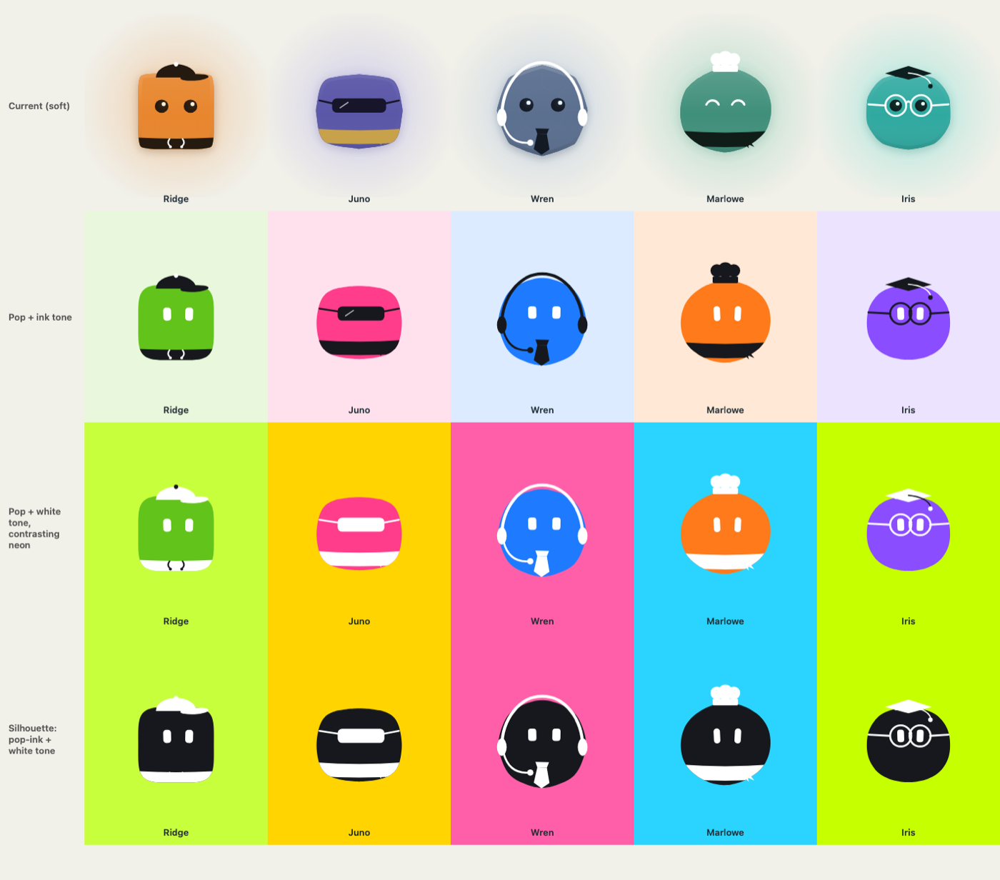
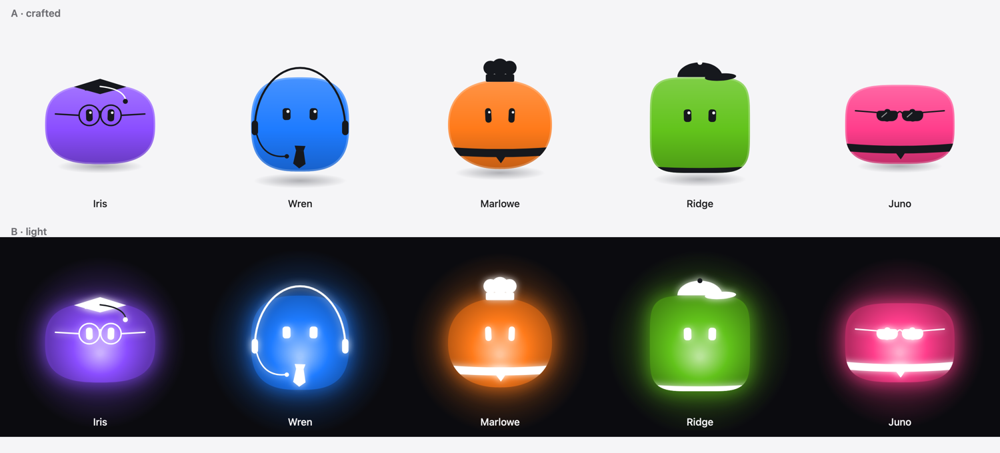

# buddykit



Living 2D characters for AI companions. One seed + a handful of traits → an
animated being with states, emotes, and a wardrobe. Canvas 2D, spring physics,
zero dependencies.

```sh
npm install @metonymous/buddykit
```

```ts
import { mountBuddy } from "@metonymous/buddykit";

const buddy = mountBuddy(canvasEl, {
  species: "blob",        // "emblem" (ghost) | "blob" (soft, two-eyed) | "block" (stacked slabs)
  body: "round", eyes: "slit", theme: "pop-cobalt",   // eyes also: googly | glint | dot | arc | ring | lens (one optic)
  build: "stout",         // block species: stout | tall | wide | mini | long | sentinel
  family: "tetra",        // emblem shell: tetra | octa | ring | petal | shard | prism | codex (open book) | fan (peacock tail)
  core: "sphere",         // emblem core: sphere | d20 | cube | d12 | gem | spine (a book's binding)
  accessories: ["ears", "bowtie"],
  accessoryColors: { bowtie: "#d6453d" },   // per-accessory color overrides
  gravity: 0,             // 0 playful → 1 grave: hard corners, muted light, narrow eyes, slow motion
  hardness: 0,            // 0 soft blob → 1 rigid faceted core
  shell: false,           // orbit the emblem's plate ring around any blob
  seed: 42,               // same seed → same being
});

buddy.setState("working");   // idle | listening | working | needs_you | away
buddy.fire("joy");           // joy | surprise | nod | shake | sad | angry | tired | annoyed | dance
buddy.configure({ theme: "sumi", accessories: ["tophat", "monocle", "cape"] });
const cfg = buddy.getConfig();   // a buddy IS its config — store it, remount it anywhere
buddy.destroy();
```

### Pop: the bold-silhouette look



```ts
mountBuddy(canvasEl, {
  species: "blob", body: "bean", eyes: "slit", eyeShift: 0.16,
  finish: "pop",              // one flat colour, a crisp still edge, no glow, dust, bevel or gradient
  theme: "pop-pink",          // pop-lime | pop-pink | pop-cobalt | pop-tangerine | pop-violet | pop-ink, or popTheme("#hex")
  accessories: ["scarf", "sunglasses"],
  accessoryTone: "#16181d",   // every accessory in one colour; details flip to stay visible
  groove: 0.6,                // idle dance: hops on a 120 bpm beat, leaning side to side
});
```

`finish` defaults to `"crafted"`. With no config at all you get the Nym-site look:
a crafted `pop-cobalt` blob with slit ink eyes. Configs that set `eyes` or `theme`
keep them; pass `finish: "soft"` for the original glowing look. `pop-ink` with a white `accessoryTone` is the silhouette: an ink figure
whose hat, headset or scarf is the one bright thing on it. `fire("dance")` plays
the full dance once on any species.

### Crafted and light: made objects



`finish: "crafted"` is a made object: an exact silhouette (one clean curve per body),
lit like soft-touch plastic from above and resting on a ground shadow, with ink eyes
and a catchlight. `finish: "light"` is a being of light: its colour glows from inside
with a halo of its own hue, and its eyes and accessories glow white; it is made for
dark grounds. Both draw accessories in a finer, even line and default their colour
(ink for crafted, white for light) unless `accessoryTone` says otherwise, and both
breathe, since their edge is still.

A buddy is deterministic from its config: `getConfig()` → JSON →
`mountBuddy(canvas, cfg)` reproduces the identical character. `renderPosterPng`
exports a static frame.

Demo: `npm install && npm run dev`.

License: Apache-2.0
